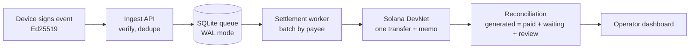

# HertzSync

> **Durable micro-settlement for DePIN devices on Solana DevNet.**
> Nothing lost. Nothing paid twice, on the ledger. Every event reconciled.

**Repository:** https://github.com/wadherashivankar2-cmd/HertzSync

[](TESTS.md)
[](SECURITY.md)
[](KNOWN_LIMITS.md)
[](KNOWN_LIMITS.md)

---

## Table of Contents

1. [Run it in 5 commands](#run-it-in-5-commands)
2. [The problem](#the-problem)
3. [What HertzSync does](#what-hertzsync-does)
4. [Why this design](#why-this-design)
5. [Lifecycle: from device event to on-chain proof](#lifecycle-from-device-event-to-on-chain-proof)
6. [Architecture](#architecture)
7. [Key features](#key-features)
8. [Verification evidence](#verification-evidence)
9. [Security](#security)
10. [Known limits](#known-limits)
11. [How this project was built (AI disclosure)](#how-this-project-was-built-ai-disclosure)
12. [Project structure](#project-structure)
13. [Full setup guide](#full-setup-guide)
14. [Commands reference](#commands-reference)
15. [Troubleshooting](#troubleshooting)
16. [Documentation index](#documentation-index)
17. [Naming note](#naming-note)

---

## Run it in 5 commands

Requires Node.js 20 or 22 and npm 10 or later. Use three terminals: one for the web app, one for the worker, one for the simulator.

```bash
# Terminal 0: once, from the project folder
npm install
cp .env.example .env.local            # Windows PowerShell: Copy-Item .env.example .env.local
npm run keygen                         # creates the DevNet treasury keypair
npm run seed                           # creates the database, business, and three simulated devices
```

```bash
# Terminal 1: web app (leave running)
npm run build
npm run start
```

```bash
# Terminal 2: settlement worker (leave running)
npm run worker
```

```bash
# Terminal 3: simulated device traffic
npm run sim
```

Then open **http://localhost:3000**. The welcome page opens first. Click **Open operator console** to reach the dashboard at `/dashboard`.

> Before the first settlement, fund the treasury with free DevNet SOL. Use the address printed by `npm run keygen`:
> `solana airdrop 1 <TREASURY_ADDRESS> --url devnet`, or the faucet at https://faucet.solana.com

A fresh clone shows zero events until the simulator runs. That is intentional.

---

## The problem

Connected devices (EV chargers, Wi-Fi hotspots, sensors, metered APIs) earn small amounts many times a day. Three things break when you try to pay for them on a blockchain:

| Problem | What happens in practice |
|---|---|
| **Fees dominate small amounts** | Paying a separate on-chain transaction for each 1-cent session costs more than the session earns. |
| **Networks fail** | When the RPC provider is unavailable, a naive system either drops the events or blocks the device. |
| **Retries double-pay** | When a confirmation is slow, a naive retry can send the same payment twice. |
| **Nobody can prove the books** | Operators and customers have no shared, checkable record that every event was counted exactly once. |

Operators lose earnings. Customers get charged twice. Nobody can audit what happened. HertzSync is built around these four failure modes.

---

## What HertzSync does

HertzSync is a reliability layer between device events and Solana. It is a middle layer for a business's systems, not a consumer wallet.

1. **Accepts signed events.** Each device signs its usage event with its own Ed25519 key. The server verifies the signature and rejects forgeries.
2. **Stores before it settles.** Accepted events are written to a local SQLite database in WAL mode before any blockchain call is made.
3. **Batches them.** A background worker groups waiting events by payee into batches with a total amount.
4. **Settles on Solana DevNet.** Each batch becomes one transfer transaction with a memo that records the batch ID and a hash of its event IDs.
5. **Recovers automatically.** If RPC endpoints fail, events keep queuing. When the network returns, the worker resumes and settles the backlog.
6. **Proves the books.** A reconciliation check confirms: generated = paid + waiting + flagged-for-review, with lost = 0 and on-chain duplicates = 0.

---

## Why this design

HertzSync is built on the principle that **the record must exist before the money moves**. That single decision drives every other property.

| Dimension | Typical per-event on-chain approach | Batch-only approach (no durable queue) | HertzSync |
|---|---|---|---|
| Fee per 1-cent event | Full network fee per event | Low, but lost events on outage | One transaction per batch |
| Behaviour during RPC outage | Events fail or block the device | Events held in memory, lost on crash | Events persisted in SQLite, survive crashes |
| Double-payment risk on retry | High unless carefully handled | Medium | Retries resend the identical signed transaction, and only rebuild after proven expiry (`tests/unit/retry-policy.test.ts`) |
| Forged events | Depends on the application | Depends on the application | Rejected at ingest by Ed25519 verification |
| Duplicate events from devices | Depends on the application | Depends on the application | Idempotent key `(device, epoch, seq)`: same content returns 200, conflicting content returns 409 |
| Proof that the books balance | Usually none | Usually none | Live reconciliation: generated = paid + waiting + review, lost = 0 |
| Chain safety | Depends on configuration | Depends on configuration | Refuses to start unless the genesis hash matches DevNet |

The difference is not a single feature. It is that each failure mode has a named mechanism, a test that exercises it, and a number on the dashboard that shows whether it held.

---

## Lifecycle: from device event to on-chain proof



### Step by step

1. **Device signs.** A charger records one session and signs the canonical JSON of the event with its private key. The private key never leaves the device.
2. **Server verifies.** `POST /api/v1/events` checks the API key, the device's ownership and status, the schema, and the Ed25519 signature. Invalid requests get 400, 401, 403, or 409 with a clear error code.
3. **Event is stored.** The event is inserted with state `queued` in the same transaction that updates the `generated_by_ingest` counter. A repeat with identical content returns 200 and is stored once.
4. **Worker batches.** Every few seconds the worker takes queued events, groups them by payee, respects a maximum batch size and maximum lamport total, and writes a batch row in state `built`.
5. **Worker settles.** The worker fetches a fresh blockhash immediately before signing, stores the signed transaction and its signature in SQLite, then submits it. It polls until the transaction is confirmed.
6. **Outage handling.** If an RPC endpoint fails, a circuit breaker opens and traffic goes to the second endpoint. If every endpoint is unavailable, the batch stays in place, events keep arriving, and nothing is marked paid.
7. **Retry safety.** A batch whose signature is not yet confirmed is resent only as the identical signed transaction, while its blockhash is still valid. A new transaction is built only after the old one is proven to have expired.
8. **Reconciliation.** The worker recomputes the equation on startup and on a schedule. The result is written to the `reconciliations` table, which the dashboard reads.
9. **Restart after a crash.** If the process is killed, the next start resumes every batch in `submitted` or `retrying` before creating new batches.

---

## Architecture

```
Device (simulated Ed25519 signer)
        │  POST /api/v1/events  (API key + signature)
        ▼
┌──────────────────────────┐        ┌────────────────────────────┐
│ Next.js app (port 3000)  │        │ Settlement worker          │
│ - ingest API             │        │ - batcher                  │
│ - metrics / batches API  │        │ - settle (retry rules)     │
│ - operator dashboard     │        │ - reconciliation           │
│ - chaos controls (dev)   │        │ - graceful shutdown        │
└────────────┬─────────────┘        └──────────────┬─────────────┘
             │                                      │
             └──────────►  SQLite (data/trickle.db, WAL)  ◄────────┘
                           events, batches, counters, system_state,
                           rate_windows, reconciliations, audit_log
                                        │
                                        ▼
                         Solana DevNet RPC router
                         (two endpoints, circuit breakers, failover)
```

**Single host by design.** Both processes share one SQLite file. Shared state, such as circuit breaker status and chaos flags, lives in SQLite, never in process memory. This is what lets a button in the dashboard change the worker's behaviour.

---

## Key features

**Ingest and integrity**
- Ed25519 signature verification over a canonical, key-ordered JSON payload.
- Idempotent events keyed by device, epoch, and sequence number.
- A device that loses its local state starts a new epoch, so legitimate resets are accepted without collisions.
- SQLite-backed fixed-window rate limiting per API key (atomic upsert).
- API keys stored only as SHA-256 hashes.

**Settlement**
- Batching per payee with a maximum event count and maximum lamport total.
- Memo format `trickle:v1:<batchId>:<eventsHash>`, length-checked before signing.
- Treasury balance guard: no transaction is sent if the balance cannot be read or is below the configured minimum.
- Fresh blockhash fetched immediately before every signature.

**Resilience**
- RPC router with two endpoints, per-endpoint circuit breakers, timeouts, and failover.
- Cross-check of confirmations against a second endpoint, so a single lying RPC cannot mark a batch as paid.
- Graceful shutdown on SIGINT and SIGTERM, with a second signal forcing exit.
- Crash recovery verified with SIGKILL during a live batch.

**Proof**
- Live reconciliation with lost, on-chain duplicates, and the conservation equation.
- A chain check that scans the treasury's full transaction history and fails if any event hash appears in more than one confirmed batch.
- Explorer links for every settled batch.

**Operator dashboard**
- Metrics cards for received, waiting, paid, and lost events, each read from SQLite.
- Settlement pipeline view, reconciliation proof, batch table, plain-English audit log in UTC, RPC endpoint health, and chaos controls.
- Dark and Light modes.
- Keyboard-accessible controls, focus rings, and reduced-motion support.

**Operations**
- `npm run backup` writes an atomic, timestamped copy of the database using `VACUUM INTO`.
- `npm run report` prints a plain-English audit and reconciliation summary.
- A 404 page and a welcome page that explains the product before the dashboard.

---

## Verification evidence

Every claim below can be reproduced from this repository.

| Check | Result | Where to look |
|---|---|---|
| Unit, integration, security, and chaos tests | 115 tests in 36 files passing on the last full run | `npm test`, see [TESTS.md](TESTS.md) |
| Outage test | 10 events queued during a 20-second outage, lost = 0 | `tests/chaos/outage.test.ts` |
| Crash test | SIGKILL during a live batch, restart resumes it, same signature and serialized transaction, no rebuild | `tests/chaos/crash-midbatch.test.ts` |
| Burst test | 1,000 events, zero drops, local ingest p95 of 7.45 ms and 15.5 ms across two runs, peak WAL recorded | `tests/load/burst.test.ts` |
| Settled demo data | 65 events received, 65 paid, 0 waiting, 0 lost, 2 batches on DevNet | Dashboard, or `npm run report` |
| Production dependencies | 0 critical, 1 high (approved exception), 5 moderate | `npm audit --omit=dev`, [SECURITY.md](SECURITY.md) |
| Mainnet guard | Refuses to start unless the genesis hash matches DevNet | `tests/unit/config.test.ts` |
| Accessibility | axe-core checked on the dashboard in both themes; results recorded in [TESTS.md](TESTS.md) | [TESTS.md](TESTS.md) |

**Example settlement transactions (DevNet, finalised):**
- https://explorer.solana.com/tx/3CLNQ4LrkUotzS5k6Ph583h3qqVnY4DEZfSm83aVUsCPZycTeA5txidsu93doUCS5L1BcDU7BQyo8q72LkbnJdcN?cluster=devnet
- https://explorer.solana.com/tx/5hC4U8kozxdAQaFTABU6W8vSwRw97dmkKJ2wdUfWVRKVyr47pPZs2aSu7NPWQURKucJSWJ64mwmcHpAGbGarEuAo?cluster=devnet

---

## Security

HertzSync's threat model covers twenty named threats (S1–S20). Each has a control and a test, with three documented gaps:

- **S1** replayed events, **S2** forged events, **S3** cross-business device spoofing, **S4** mainnet use, **S6** plaintext API keys, **S7** oversized amounts, **S8** duplicate payment on retry, **S9** a single lying RPC, **S10** API flooding, **S11** malformed input, **S13** chaos routes in production, **S14** treasury drain, **S16** device reset drops events, **S17** conflicting content accepted, **S18** memo bloat, **S19** cross-process state drift, **S20** interrupted shutdown.
- **S5** key leakage, **S12** dependency scanning as a test, and **S15** log redaction are documented gaps. Each is described in [SECURITY.md](SECURITY.md) with the reason it is not yet covered by an automated test.

**Dependency audit (production only):** 0 critical. One high-severity finding in PostCSS, bundled inside Next.js 15.5.29, runs only at build time on the project's own CSS. It is recorded as an approved exception. Five moderate findings come from the pinned `@solana/web3.js` 1.x line, and the feature usage that matters is documented in SECURITY.md.

**Development-only findings:** `npm install` reports two critical findings in Vitest and its worker pool. They are dev-only and are not installed by `npm install --omit=dev`.

**Keys:** the treasury keypair (`keys/treasury.json`) and device keys (`keys/devices/`) are gitignored. Environment secrets live in `.env.local`, also gitignored.

---

## Known limits

Stated plainly so you can judge the project on what it actually is:

- **DevNet only.** It is not audited and does not handle real funds. The mainnet guard exists, but nothing here is production-ready.
- **Simulated devices.** Device events come from a software simulator that signs with Ed25519 keys. No physical hardware has been tested.
- **Single host.** One machine, one SQLite file, two processes. It is not designed for multi-server or serverless deployment.
- **Treasury is server-held.** Settlement is paid from one DevNet treasury keypair, not from each user's wallet.
- **No sybil resistance.** Nothing stops a fake device from submitting valid-looking signed events. Device identity is registered by the operator.
- **No user accounts.** The welcome page is an entry point, not a login. The admin key used by chaos controls is a development-only control.
- **Test history on-chain.** Early test runs sent real DevNet transfers to throwaway addresses. Some early batch memos reuse fixed test event hashes. Both are disclosed, with signatures, in [KNOWN_LIMITS.md](KNOWN_LIMITS.md). Duplicate detection inside the app is per database; cross-run uniqueness is checked against the chain.
- **Demo data reset.** The database was reset before the final demo run. Earlier counts are superseded.

---

## How this project was built (AI disclosure)

This project was built with AI assistance, and the work is disclosed here so you can judge it accordingly.

- **Tools used:** Google Antigravity IDE with Gemini models as the coding agent, and Claude as an advisor for planning, review, and wording. The human author (Shivankar Wadhera) directed every phase, approved every gate, and ran the commands on their own machine.
- **What the AI did:** wrote most of the TypeScript and tests, drafted documentation, and produced verification reports.
- **What the human did:** wrote the blueprint and its rules, chose the scope, reviewed each report against the acceptance criteria, ran the checks independently, and decided what to cut under time pressure.
- **How outputs were checked:** tests were re-run locally, the database was queried directly, on-chain transactions were checked on the public Explorer, and reports were rejected when they contradicted the evidence. Several errors were caught this way, including a simulator signing bug, a duplicate-hash check that passed on data that contained duplicates, and an outage test that did not actually run an outage. Those fixes are recorded in [PROGRESS.md](PROGRESS.md) and [KNOWN_LIMITS.md](KNOWN_LIMITS.md).
- **Where to be skeptical:** any AI-written claim should be verified by running the command it refers to. The commands are listed in the commands reference below.

---

## Project structure
HertzSync/
├── db/ schema.sql and migration script
├── docs/ demo-script.md and supporting docs
├── scripts/ keygen, seed, device-sim, report, backup
├── src/
│ ├── app/ Next.js pages and API routes
│ │ ├── welcome/ landing page
│ │ ├── dashboard/ operator console
│ │ └── api/v1/ events, batches, metrics, reconciliation, chaos
│ ├── components/ dashboard panels and theme switch
│ ├── lib/ config, canonical JSON, crypto, RPC router, metrics, rate limiting
│ ├── worker/ batcher, settlement, reconciliation, chain check, lifecycle
│ └── types/ type declarations
├── tests/ unit, integration, security, chaos, load, e2e
├── .env.example every configuration variable, with placeholder values
├── BLUEPRINT.md the full build specification
├── PROGRESS.md phase-by-phase record of what was built and verified
├── TESTS.md test inventory and run results
├── SECURITY.md threat model S1–S20, dependency audit, exceptions
├── KNOWN_LIMITS.md scope, limits, and historical disclosures
└── README.md this file

---

## Full setup guide

### 1. Prerequisites

- Node.js 20 or 22 (`node -v`)
- npm 10 or later (`npm -v`)
- Git (`git --version`)
- Solana CLI (optional, for checking balances: `solana --version`)

### 2. Install dependencies

```bash
npm install
```

Expected output ends with `added N packages` and an audit summary. The critical findings reported here are in development tooling only, as explained in the notice below.

> **Audit notice:** `npm install` reports critical findings in development tooling (`vitest@2.1.9` and `tinypool@1.1.1`). These packages are excluded by `npm install --omit=dev` and are not part of the production runtime. Run `npm audit --omit=dev` to check runtime dependencies. It reports 0 critical and 6 findings (5 moderate, 1 high). The high finding is an approved exception, described in [SECURITY.md](SECURITY.md).

### 3. Create the environment file

macOS or Linux:
```bash
cp .env.example .env.local
```

Windows PowerShell:
```powershell
Copy-Item .env.example .env.local
```

Windows Command Prompt:
```cmd
copy .env.example .env.local
```

The defaults point at DevNet and need no changes for the demo. Do not set `CLUSTER` to anything other than `devnet`; the app will refuse to start.

### 4. Generate the treasury keypair

```bash
npm run keygen
```

This writes `keys/treasury.json` and prints the public address. The private key is never printed.

### 5. Fund the treasury (free DevNet SOL)

```bash
solana airdrop 1 <TREASURY_PUBLIC_ADDRESS> --url devnet
```

Or use the faucet at https://faucet.solana.com with the printed address. Faucets are rate-limited; wait and retry if one refuses. Check the balance:

```bash
solana balance <TREASURY_PUBLIC_ADDRESS> --url devnet
```

### 6. Create the database and simulated devices

```bash
npm run seed
```

This creates `data/trickle.db`, one demo business, two payees, and three simulated chargers. Device keys are written to `keys/devices/`, which is gitignored.

### 7. Build and start the web app

```bash
npm run build
npm run start
```

Open http://localhost:3000. The welcome page is the entry point, and the dashboard is at http://localhost:3000/dashboard.

For development with hot reload, use `npm run dev` instead of build and start. The production build is what judges should use, because it does not show the development overlay.

### 8. Start the settlement worker

In a separate terminal:

```bash
npm run worker
```

Wait for `Startup sequence complete. Worker ready.` The worker verifies the DevNet genesis hash, runs an integrity check, reconciles, and then begins batching.

### 9. Send simulated device traffic

In a third terminal:

```bash
npm run sim
```

The simulator signs events with each device's key and posts them to the ingest API. Optional flags: `--count=N` and `--interval=MS`.

Check the result:

```bash
curl.exe http://localhost:3000/api/v1/metrics        # Windows PowerShell
curl http://localhost:3000/api/v1/metrics            # macOS / Linux
```

Look for `events_queued` (goes to 0 as the worker settles), `events_paid` (rises), and `events_lost` (stays 0).

---

## Commands reference

| Command | What it does |
|---|---|
| `npm install` | Installs dependencies from the lock file |
| `npm run keygen` | Creates the DevNet treasury keypair in `keys/treasury.json` |
| `npm run seed` | Creates the database, demo business, payees, and simulated devices |
| `npm run build` | Production build of the web app |
| `npm run start` | Serves the production build on port 3000 |
| `npm run dev` | Development server with hot reload (port 3000) |
| `npm run worker` | Starts the settlement worker: batching, settlement, reconciliation |
| `npm run sim` | Sends simulated, Ed25519-signed device events to the ingest API |
| `npm run report` | Prints a plain-English audit and reconciliation summary |
| `npm run backup` | Writes a timestamped copy of the database to `backups/` (`VACUUM INTO`) |
| `npm test` | Runs the full test suite (115 tests across 36 files) |
| `npm audit --omit=dev` | Lists vulnerabilities in production dependencies only |

---

## Troubleshooting

| Symptom | Likely cause | Fix |
|---|---|---|
| `curl: (7) Could not connect` | The web app is not running | Start `npm run start` (or `npm run dev`) and wait for `Ready` |
| Simulator prints `NETWORK_ERR` | The web app is not running or is on another port | Start the web app first; the simulator targets `http://localhost:3000` |
| Simulator prints `invalid_signature` | Device key files and database keys are out of step | Run `npm run seed` again on a fresh `data/trickle.db`, then restart the worker |
| Worker reports `Treasury balance` warnings | The treasury has not been funded | Fund it with the `solana airdrop` command in step 5 |
| Worker refuses to start with a genesis hash error | `CLUSTER` is not `devnet`, or the RPC points at another network | Check `.env.local`; the app is DevNet-only by design |
| Dashboard shows zero events | The simulator has not run yet | Run `npm run sim` and refresh |
| A Next.js error badge appears on the page | Development mode overlay | Use `npm run build` and `npm run start` |
| `better-sqlite3` fails to install on Windows | Missing C++ build tools | Install Visual Studio Build Tools with the C++ workload, then run `npm install` again |

---

## Documentation index

- [SECURITY.md](SECURITY.md): threat model S1–S20, dependency audit, and approved exceptions
- [TESTS.md](TESTS.md): test inventory, chaos tests, burst load results, and run history
- [KNOWN_LIMITS.md](KNOWN_LIMITS.md): scope, single-host model, simulated devices, and historical records
- [BLUEPRINT.md](BLUEPRINT.md): the full specification the build followed
- [PROGRESS.md](PROGRESS.md): phase record, including what was cut and what was verified
- [docs/demo-script.md](docs/demo-script.md): the 90-second demo script with exact steps

---

## Naming note

The project was renamed from TrickleSettle to **HertzSync** on 8 November 2026. Some internal names deliberately keep the earlier name so existing data and on-chain records still match:

- The database file remains `data/trickle.db`.
- Environment variable names such as `DB_PATH` and `TREASURY_MIN_LAMPORTS` are unchanged.
- On-chain memos keep the prefix `trickle:v1:<batchId>:<eventsHash>`, because changing the format would change what existing transactions mean.

---

## Licence

- **Author:** Shivankar Wadhera
- **Licence:** Not yet chosen
- **Third-party UI:** The welcome page layout was inspired by public shadcn/ui-style templates. No template code was copied.